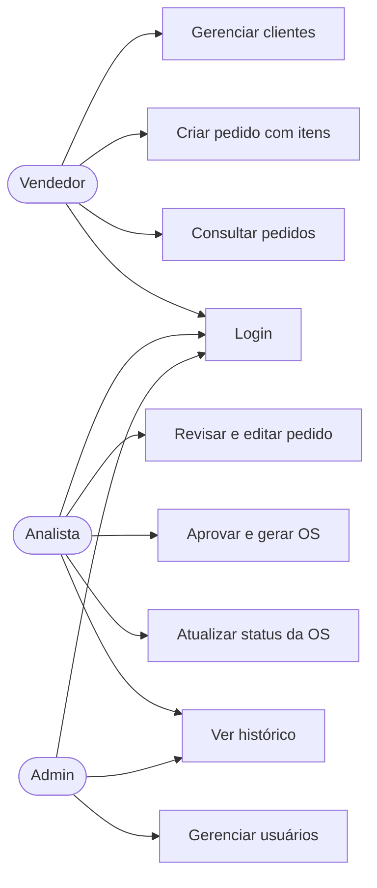
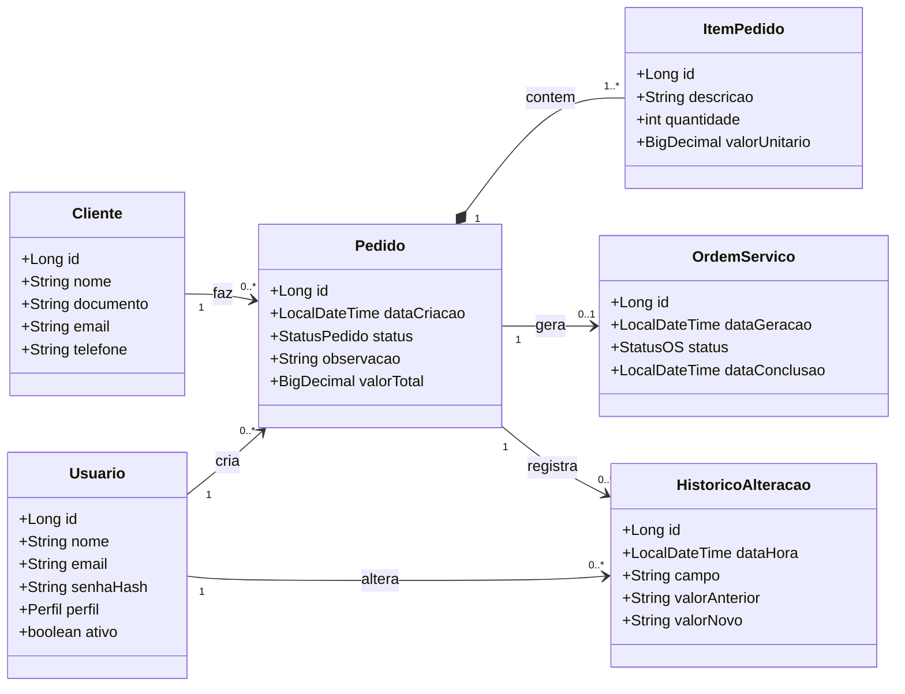
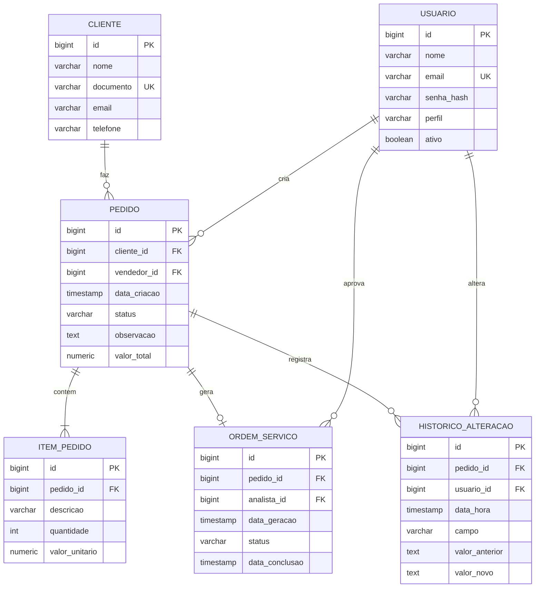
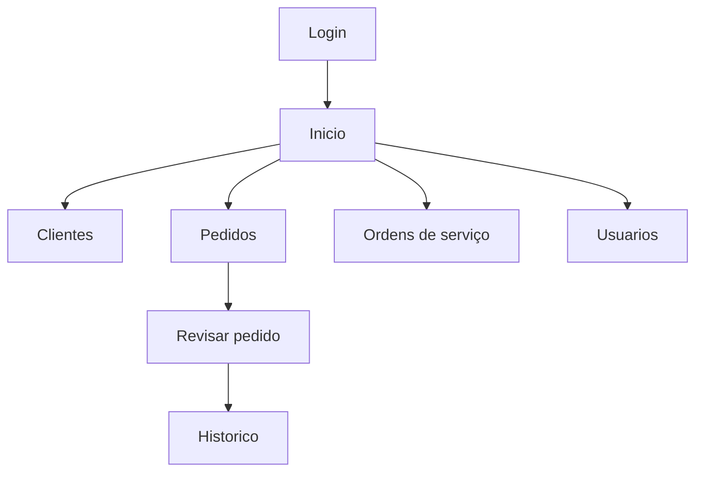

# Documentação: Situação 1

Sistema de controle de pedidos e ordens de serviço. Back-end em Java (Spring Boot, MVC), banco PostgreSQL.

## 1. Escopo

O vendedor cria pedidos para clientes. O analista revisa, corrige e modifica o pedido antes de ele virar ordem de serviço (OS). Ao aprovar, o sistema gera a OS, que passa pelos status aberta, em andamento e concluída. Toda alteração feita em um pedido fica registrada em histórico.

Perfis de usuário: vendedor, analista e admin.

Funcionalidades: login, CRUD de clientes, CRUD de pedidos com itens, tela de revisão de pedidos, geração de ordem de serviço, histórico de alterações e gerenciamento de usuários.

Fluxo do pedido: `CRIADO` > `EM_REVISAO` > `APROVADO` (gera OS) ou `CANCELADO`.

## 2. Casos de uso

## 3. Diagrama de classes

## 4. Modelo lógico (3FN)

O projeto físico está em [`database/schema.sql`](../../database/schema.sql) e o dicionário de dados em [`dicionario-de-dados.md`](dicionario-de-dados.md).

## 5. IHC: mapa de telas

Telas principais prototipadas: login, lista de pedidos, novo pedido e revisão do pedido (wireframes em `wireframes/`).

Princípios de IHC aplicados: menu igual em todas as telas (consistência), mensagens de erro que dizem o que fazer (feedback), ações de remover separadas das de salvar (reversibilidade) e histórico visível na revisão (o sistema comunica o que aconteceu).
